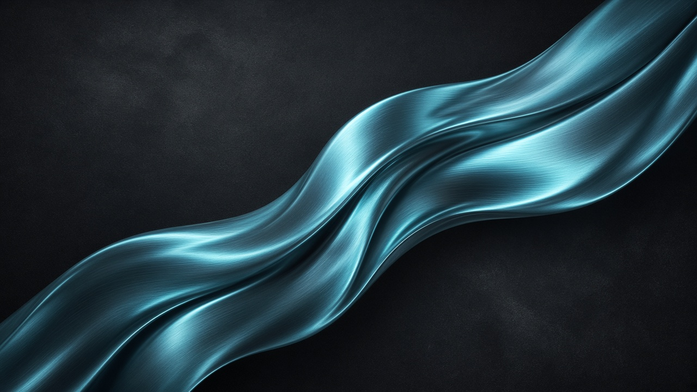

# Charcoal

A clean charcoal [Omarchy](https://omarchy.org) theme — soft graphite surfaces, cool steel accent `#7eb8c9`, Nord editor pairing, and five 4K wallpapers (plus ultrawide crops).



## Install

```bash
omarchy theme install https://github.com/McX424/omarchy-charcoal-theme.git
```

Or: **Omarchy menu → Install → Style → Theme** and paste that URL.

The theme appears as **Charcoal** in the selector.

## What’s included

| Piece | Detail |
|-------|--------|
| Palette | Graphite greys + steel accent `#7eb8c9` |
| Editors | Neovim `nordfox` · VS Code Nord |
| Icons | `Yaru-dark` |
| Hyprland | Soft steel active border + light shadow |
| btop | Charcoal `btop.theme` |
| Chromium | Steel mist frame RGB `24,32,40` (#182028) |
| Lock screen | `shell.lock.toml` + unlock art |
| Keyboard RGB | Steel accent |
| Wallpapers | Five 4K (3840×2160) + ultrawide 3440×1440 and 3840×1600 crops |

## Wallpapers

Cycle 4K backgrounds with Style wallpaper next / `omarchy-theme-bg-next` (Omarchy reads files directly under `backgrounds/`).

| File | Mood |
|------|------|
| `01-ridge-aurora.jpg` | Ridgeline under a cool steel aurora |
| `02-liquid-steel.jpg` | Flowing graphite / steel gradients |
| `03-rain-city.jpg` | Wet city night, charcoal haze |
| `04-lattice.jpg` | Soft geometric lattice on ink |
| `05-abyss.jpg` | Deep charcoal abyss |

### Ultrawide (34″)

Ultrawide crops live in subfolders (not in the default cycle — set explicitly):

```bash
omarchy theme bg set ~/.config/omarchy/themes/charcoal/backgrounds/ultrawide-3440/01-ridge-aurora.jpg
# or 3840×1600:
omarchy theme bg set ~/.config/omarchy/themes/charcoal/backgrounds/ultrawide-3840x1600/01-ridge-aurora.jpg
```

| Folder | Resolution |
|--------|------------|
| `backgrounds/ultrawide-3440/` | 3440×1440 |
| `backgrounds/ultrawide-3840x1600/` | 3840×1600 |

Same five filenames in each folder.

## Editors

- **Neovim / LazyVim** — `neovim.lua` loads [nightfox.nvim](https://github.com/EdenEast/nightfox.nvim) with `nordfox`
- **VS Code** — `vscode.json` → Nord (`arcticicestudio.nord-visual-studio-code`)

## Palette

| Token | Hex |
|-------|-----|
| background | `#141416` |
| dark_background | `#0c0c0e` |
| lighter_background | `#1e1e22` |
| foreground | `#d8d8dc` |
| dark_foreground / muted text | `#6e6e76` |
| accent | `#7eb8c9` |
| selection | `#2a2a32` |

Terminal ANSI stays desaturated; `bright_*` is nudged slightly for readable git diffs without going neon.

## Remove

```bash
omarchy theme remove charcoal
```

(Or **Remove → Style → Theme** in the Omarchy menu.)

## Notes for distributors

- Repo naming follows `omarchy-[name]-theme` so install shows as **Charcoal**.
- Optional: list on the [extra themes](https://omarchy.org) page via a PR to the omarchy-site repo.

## License

MIT © McX424
